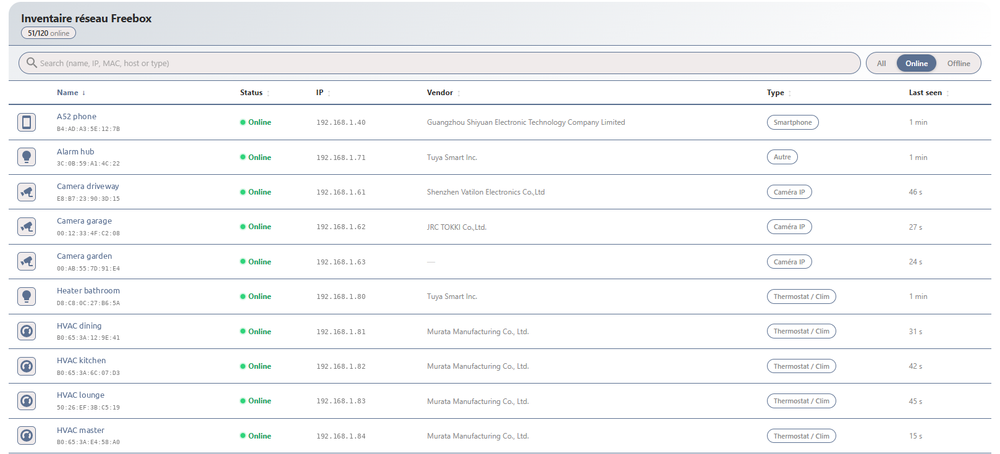

# Freebox Network Inventory

[](https://www.home-assistant.io/)
[](https://github.com/hacs/integration)
[](https://github.com/freddye83/freebox-network-inventory/releases)
[](LICENSE)

> Home Assistant integration providing a full **network inventory** of your Freebox.
> A companion to the official Freebox integration — focused on **inventory** rather than presence.

🇫🇷 [Version française plus bas](#-version-française)



---

## Why this integration?

The official Freebox integration creates `device_tracker` entities for presence detection.
A **network inventory** is a different need: knowing every device connected to your network, its IP, its vendor, being alerted when a new one shows up, renaming it and reserving its IP — all from Home Assistant.

**Freebox Network Inventory does not replace the official integration — it complements it.**

---

## Features

- ✅ **One HA device per MAC address** (Settings → Devices)
- ✅ **4 entities per device**: status, online, editable name, editable type
- ✅ **Name and type changes pushed to Freebox OS** in real time
- ✅ **DHCP static leases** (IP reservations): create, update, delete — from a service or from the card
- ✅ **Full static lease list** in a dedicated sensor (including leases whose device is no longer on the network)
- ✅ **All details as attributes**: IPv4, IPv6, vendor, type, domain, access point, persistent, static lease, timestamps
- ✅ **4 global sensors**: total, online, new devices, static leases
- ✅ **Built-in Ethernet switch**: link, speed, duplex, throughput, errors per port
- ✅ **Automatic notification** for every newly detected device
- ✅ **HA event** `freebox_network_inventory_new_device` for automations
- ✅ **Diagnostics** page
- ✅ **Config flow** (no YAML)
- ✅ **Configurable polling interval** (10–3600 s, default 60 s)
- ✅ **EN / FR translations**
- ✅ **No `device_tracker` created**

---

## Installation

### Home Assistant 2026.11 and later — Marketplace

Since 2026.11, HACS is built into Home Assistant as the **Marketplace**. Until this repository is listed in the default catalog, add it as a custom repository:

1. Open **Settings → Marketplace**.
2. On first visit, read the community-content notice and select **I understand the risks and agree**.
3. Select **Add from link** and paste `https://github.com/freddye83/freebox-network-inventory`.
   Custom repositories require a GitHub connection: approve the device sign-in on GitHub when prompted (read-only access to public data).
4. Open **Freebox Network Inventory** and select **Install**. The setup flow opens right away — no restart needed for a first install (updates still require a restart).

[](https://my.home-assistant.io/redirect/hacs_repository/?owner=freddye83&repository=freebox-network-inventory&category=integration)

> Already installed through HACS? Home Assistant migrates HACS to the Marketplace automatically on the first start after updating: the integration stays installed and keeps receiving updates.

### Home Assistant before 2026.11 — HACS

1. Open **HACS**
2. **Integrations** → ⋮ menu → **Custom repositories**
3. URL: `https://github.com/freddye83/freebox-network-inventory` — Category: **Integration** → **Add**
4. Search for **Freebox Network Inventory** and install it
5. Restart Home Assistant

### Manual installation

1. Download the latest [release](https://github.com/freddye83/freebox-network-inventory/releases)
2. Copy `custom_components/freebox_network_inventory` into `/config/custom_components/`
3. Restart Home Assistant

---

## Configuration

1. **Settings → Devices & services → Add integration**
2. Search for **Freebox Network Inventory**
3. Enter your Freebox address (`mafreebox.freebox.fr` by default)
4. **Press the arrow button** on the Freebox LCD screen to grant access
5. Click **Submit** ✅

> **Note:** the integration requests the `settings` and `lan` permissions so it can rename devices, change their type and manage DHCP static leases.
> If you installed a version older than 1.2.0, check in **Freebox OS → Settings → Access management → Applications** that *Freebox Network Inventory* has the **Freebox settings modification** permission, otherwise static leases stay read-only.

---

## Entities

### Per network device

```
Living room TV  (AA:BB:CC:DD:EE:01)
│
├── binary_sensor.freebox_network_inventory_living_room_tv_en_ligne
│     state: on / off
│
├── sensor.freebox_network_inventory_living_room_tv
│     state: online / offline
│     attributes:
│       mac, ipv4, ipv6, ip_list, ip_count
│       vendor, hostname, alias, host_type
│       domain_name, access_point_mac, ap_speed_mbps
│       reachable, active, persistent
│       static_lease, static_ip, static_lease_comment
│       first_seen, last_seen, last_activity
│
├── text.freebox_network_inventory_living_room_tv_nom
│     Editable name → pushed to Freebox OS
│
└── select.freebox_network_inventory_living_room_tv_type
      Editable type (TV, Smartphone, NAS…) → pushed to Freebox OS
```

### Global sensors (hub)

```
Freebox Network Inventory
├── sensor.freebox_network_inventory_devices_online    → 44
├── sensor.freebox_network_inventory_devices_total     → 66
├── sensor.freebox_network_inventory_devices_new       → 0
└── sensor.freebox_network_inventory_static_leases     → 12
      attributes:
        leases: [{mac, ip, comment, hostname, name, online, known}, …]   (sorted by IP)
        dhcp_range_start, dhcp_range_end, gateway, netmask
```

`known: false` means the lease belongs to a MAC address that the Freebox no longer lists (old device, replaced hardware…) — handy for cleaning up.

---

## DHCP static leases

### Services

| Service | Fields | Description |
|---|---|---|
| `freebox_network_inventory.set_static_lease` | `mac`, `ip`, `comment` (optional) | Creates the lease, or updates it if the MAC already has one |
| `freebox_network_inventory.remove_static_lease` | `mac` | Deletes the lease |

```yaml
action: freebox_network_inventory.set_static_lease
data:
  mac: "AA:BB:CC:DD:EE:01"
  ip: 192.168.1.10
  comment: NAS
```

Notes:
- Choose an IP **outside the dynamic DHCP range** (shown in the `static_leases` sensor attributes) to avoid conflicts.
- A device keeps its current IP until its next DHCP renewal (or reconnection). The card flags this with an orange lock.
- An IP already reserved for another MAC is rejected before reaching the Freebox.

### Listing all static leases

- **From the card**: **Static** filter button — shows every reserved IP, including orphan leases.
- **From a template**:

```jinja

{{ l.ip }} → {{ l.name }} ({{ l.mac }}){{ ' — ' ~ l.comment if l.comment }}

```

- **From a Markdown card**:

```yaml
type: markdown
title: Static leases
content: |
  | IP | Name | MAC | |
  |---|---|---|---|
  
  | {{ l.ip }} | {{ l.name }} | `{{ l.mac }}` | {{ '🟢' if l.online else '⚪' }} |
  
```

---

## New device notification

Each time a new device appears on the network, a persistent notification is created in HA:

> **🔍 Nouvel équipement réseau détecté**
> Name: ESP32 Garage — MAC: AA:BB:CC:DD:EE:42 — Vendor: Espressif Inc. — IP: 192.168.1.92

A `freebox_network_inventory_new_device` event is also fired:

```yaml
automation:
  alias: "New network device"
  triggers:
    - trigger: event
      event_type: freebox_network_inventory_new_device
  actions:
    - action: notify.mobile_app_my_phone
      data:
        title: "🔍 New network device"
        message: >
          {{ trigger.event.data.name }}
          — {{ trigger.event.data.vendor or 'Unknown' }}
          — {{ trigger.event.data.ip }}
          ({{ trigger.event.data.mac }})
```

---

## Lovelace card

A dedicated card is available in [freebox-network-inventory-card](https://github.com/freddye83/freebox-network-inventory-card):

- Filterable, sortable, paginated table — with **Persistent** column and static lease indicator
- Real-time search
- Modal popup to edit name, type and **static lease** directly from the card

---

## Diagnostics

**Settings → Devices & services → Freebox Network Inventory → Download diagnostics**

---

## Freebox API endpoints used

| Endpoint | Description |
|---|---|
| `GET /api/v8/lan/browser/pub/` | List all LAN hosts |
| `PUT /api/v8/lan/browser/pub/{id}` | Update a host (name, type) |
| `GET /api/v8/dhcp/static_lease/` | List static leases |
| `POST /api/v8/dhcp/static_lease/` | Create a static lease |
| `PUT /api/v8/dhcp/static_lease/{id}` | Update a static lease comment |
| `DELETE /api/v8/dhcp/static_lease/{id}` | Delete a static lease |
| `GET /api/v8/dhcp/config/` | DHCP range, gateway, netmask |
| `GET /api/v8/switch/status/` | Switch port status |
| `POST /login/authorize` | App token request |
| `POST /login/session` | Session opening (HMAC-SHA1) |

---

## Freebox compatibility

| Model | Tested |
|---|---|
| Freebox Ultra | ✅ |
| Freebox Revolution | ✅ |
| Freebox Pop | ✅ |
| Freebox Delta | ✅ |
| Freebox mini 4K | ✅ |

---

## Contributing

Contributions are welcome!

1. Fork the repository
2. Create a branch: `git checkout -b feature/my-feature`
3. Commit: `git commit -m "feat: my feature"`
4. Push: `git push origin feature/my-feature`
5. Open a Pull Request

---

## License

MIT — see [LICENSE](LICENSE)

---
---

## 🇫🇷 Version française

> Intégration Home Assistant pour l'**inventaire réseau** de la Freebox.
> Complément à l'intégration officielle — orientée **inventaire** plutôt que présence.

### Pourquoi cette intégration ?

L'intégration officielle Freebox crée des `device_tracker` pour la détection de présence.
Un **inventaire réseau** est un besoin différent : connaître tous les équipements connectés, leur IP, leur fabricant, être prévenu à leur première apparition, les renommer et réserver leur IP — directement depuis Home Assistant.

**Freebox Network Inventory ne remplace pas l'intégration officielle — elle la complète.**

### Fonctionnalités

- ✅ **Un appareil HA par adresse MAC** (Paramètres → Appareils)
- ✅ **4 entités par appareil** : statut, en ligne, nom éditable, type éditable
- ✅ **Modification du nom et du type répercutée sur Freebox OS** en temps réel
- ✅ **Baux DHCP statiques** (réservations d'IP) : création, modification, suppression — par service ou depuis la carte
- ✅ **Liste complète des baux statiques** dans un capteur dédié (y compris les baux dont l'appareil a disparu du réseau)
- ✅ **Tous les détails en attributs** : IPv4, IPv6, fabricant, type, domaine, point d'accès, persistant, bail statique, horodatages
- ✅ **4 capteurs globaux** : total, en ligne, nouveaux appareils, baux statiques
- ✅ **Switch Ethernet intégré** : lien, vitesse, duplex, débits, erreurs par port
- ✅ **Notification automatique** à chaque nouvel équipement
- ✅ **Événement HA** `freebox_network_inventory_new_device`
- ✅ **Diagnostics**, **Config Flow**, **intervalle configurable** (10–3600 s), **traductions FR / EN**
- ✅ **Aucun `device_tracker` créé**

### Installation

#### Home Assistant 2026.11 et ultérieur — Marketplace

Depuis la 2026.11, HACS est intégré à Home Assistant sous le nom de **Marketplace**. Tant que ce dépôt n'est pas dans le catalogue par défaut, ajoutez-le comme dépôt personnalisé :

1. Ouvrez **Paramètres → Marketplace**.
2. À la première visite, lisez l'avertissement sur le contenu communautaire et validez **I understand the risks and agree** (« Je comprends les risques et j'accepte »).
3. Choisissez **Add from link** (« Ajouter depuis un lien ») et collez `https://github.com/freddye83/freebox-network-inventory`.
   Les dépôts personnalisés nécessitent une connexion GitHub : validez la connexion de l'appareil sur GitHub (accès en lecture seule aux données publiques).
4. Ouvrez **Freebox Network Inventory** puis **Install**. L'assistant de configuration s'ouvre aussitôt — pas de redémarrage pour une première installation (les mises à jour en demandent toujours un).

> Déjà installée via HACS ? Home Assistant migre automatiquement HACS vers le Marketplace au premier démarrage après la mise à jour : l'intégration reste installée et continue de recevoir ses mises à jour.

#### Home Assistant avant 2026.11 — HACS

1. Ouvrez **HACS**
2. **Intégrations** → menu ⋮ → **Dépôts personnalisés**
3. URL : `https://github.com/freddye83/freebox-network-inventory` — Catégorie : **Intégration** → **Ajouter**
4. Recherchez **Freebox Network Inventory** et installez
5. Redémarrez Home Assistant

#### Installation manuelle

1. Téléchargez la dernière [release](https://github.com/freddye83/freebox-network-inventory/releases)
2. Copiez `custom_components/freebox_network_inventory` dans `/config/custom_components/`
3. Redémarrez Home Assistant

### Configuration

1. **Paramètres → Appareils et services → Ajouter une intégration**
2. Recherchez **Freebox Network Inventory**
3. Saisissez l'adresse de la Freebox (`mafreebox.freebox.fr` par défaut)
4. **Appuyez sur le bouton fléché** de l'écran LCD de la Freebox pour autoriser l'accès
5. Cliquez **Soumettre** ✅

> **Note :** l'intégration demande les droits `settings` et `lan` pour renommer les équipements, changer leur type et gérer les baux DHCP statiques.
> Si vous aviez installé une version antérieure à 1.2.0, vérifiez dans **Freebox OS → Paramètres → Gestion des accès → Applications** que *Freebox Network Inventory* dispose bien du droit **Modification des réglages de la Freebox**, sinon les baux statiques restent en lecture seule.

### Baux DHCP statiques

| Service | Champs | Description |
|---|---|---|
| `freebox_network_inventory.set_static_lease` | `mac`, `ip`, `comment` (facultatif) | Crée le bail, ou le modifie si la MAC en a déjà un |
| `freebox_network_inventory.remove_static_lease` | `mac` | Supprime le bail |

```yaml
action: freebox_network_inventory.set_static_lease
data:
  mac: "AA:BB:CC:DD:EE:01"
  ip: 192.168.1.10
  comment: NAS
```

- Choisissez une IP **hors de la plage DHCP dynamique** (visible dans les attributs du capteur `static_leases`).
- L'appareil garde son IP actuelle jusqu'au prochain renouvellement DHCP (ou reconnexion) — la carte l'indique par un cadenas orange.
- Une IP déjà réservée pour une autre MAC est refusée avant même d'interroger la Freebox.

**Lister tous les baux statiques :**
- dans la carte : bouton de filtre **Static** (inclut les baux orphelins) ;
- dans un template ou une carte Markdown : attribut `leases` du capteur `sensor.freebox_network_inventory_static_leases` (exemples dans la partie anglaise ci-dessus).

### Entités, notifications, API

Voir les sections anglaises ci-dessus : la structure des entités, l'événement `freebox_network_inventory_new_device`, les diagnostics et la liste des endpoints de l'API Freebox sont identiques.

### Licence

MIT — voir [LICENSE](LICENSE)
